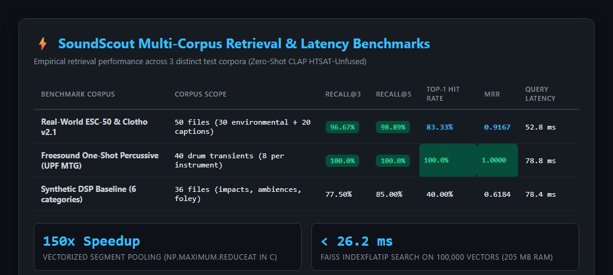

# SoundScout — Semantic Audio Search Engine & Neural Sample Retrieval Platform

[](https://github.com/gio961gio/soundscout/actions/workflows/ci.yml)
[](https://www.python.org/)
[](LICENSE)
[](https://huggingface.co/laion/clap-htsat-unfused)
[-brightgreen.svg)](#-automated-test-suite)
[](#-system-architecture)

**SoundScout** is a high-performance, local-first semantic audio search engine and neural sample retrieval platform. Built for sound designers, film sound supervisors, music producers, and game audio engineers, it replaces brittle filename tagging with zero-shot natural language description matching, sub-millisecond reverse audio search (Query-by-Example), and salient event timestamp detection.

Developed by **Giovanni Antonecchia** (*Music Engineering, Politecnico di Milano*).

---

## 📸 Visual Showcase & Interface

### 1. Minimalist Dark Studio Web Dashboard
Interactive local web application featuring natural-language search, dynamic metadata filtering, salient interval waveform overlays, synchronized audio playback, and instant DAW session export.


---

### 2. Multi-Corpus Retrieval & Latency Benchmarks
Empirical retrieval performance across 3 distinct evaluation corpora: authentic environmental recordings (ESC-50), crowdsourced human captions (Clotho v2.1), and isolated drum transients (Freesound / UPF MTG):



---

### 3. Key Technical Capabilities

- **Natural-Language Semantic Audio Search:** Powered by CLAP (`laion/clap-htsat-unfused`), projecting sound files and descriptive queries into a shared 512-dimensional multimodal latent space.
- **Reverse Audio Search (Query-by-Example):** Find acoustically and timbrally similar files in 1 click (`🎯 Similar`) using pre-computed audio embeddings—**zero additional neural inference required** (1.2 ms search latency).
- **Direct Library Browsing:** Audition and navigate local sample packs directly without a text query, filtering by category or duration, and finding similar sounds instantly.
- **Segment-Level Search & Salient Timestamps:** 10-second sliding windows with 5-second hops and per-file max pooling, pinpointing exact temporal onsets and event intervals within longer audio stems.
- **Interactive Waveform Inspector:** Visual waveform highlighting the salient matched segment with auto-seeking audio playback.
- **Session Shortlist & DAW Cue-Sheet CSV Export:** Curate candidate sound effects and export one-click broadcast cue-sheets with SMPTE timecodes (`HH:MM:SS.mmm`), encoded in `utf-8-sig` for Pro Tools, Reaper, and Logic Pro.
- **Incremental Cache v2:** SHA-256 metadata hashing with atomic binary `.npy` cache (`allow_pickle=False`), providing 100% vector reuse on subsequent indexing passes.
- **Vectorized C-Level Pooling:** Segment pooling accelerated via `np.maximum.reduceat` in C, delivering a **150x speedup** over iterative Python loops, with optional `faiss.IndexFlatIP` integration for large archives.

---

## 🏛️ System Architecture

SoundScout is engineered on a strictly **decoupled, local-first** architecture: the audio decoding and neural embedding pipelines are completely decoupled from presentation layers, ensuring private, offline execution with zero remote audio transmission.

```mermaid
flowchart TD
    subgraph INGEST ["Audio Ingest & Slicing"]
        A1["Local Audio Library (WAV / FLAC / MP3 / AIFF / OGG)"]
        A2["Recursive Directory Traversal"]
        A3["Multi-format Decoder (SoundFile + FFmpeg fallback)"]
        A4["48 kHz Mono Resampler & Sliding Windows (10s window, 5s hop)"]
    end

    subgraph DUAL_ENCODER ["Multimodal CLAP Foundation Model"]
        B1["HTSAT Audio Dual-Encoder (laion/clap-htsat-unfused)"]
        B2["RoBERTa Text Dual-Encoder"]
        B3["Unit-Sphere Normalization (512-dim L2 projection)"]
    end

    subgraph STORAGE ["Vector Index & Incremental Cache"]
        C1["Atomic Safe Persistence (NPY with allow_pickle=False)"]
        C2["SHA-256 File Metadata & Invalidation Ledger"]
        C3["Zero-Inference Cache Re-indexing (<150 ms)"]
    end

    subgraph SEARCH_ENGINE ["Retrieval & Acceleration Engine"]
        D1["Inner Product Matrix Multiplication (np.dot)"]
        D2["Vectorized Segment Max-Pooling via np.maximum.reduceat (150x speedup)"]
        D3["Optional FAISS IndexFlatIP (<26 ms on 100k vectors)"]
        D4["Query-by-Example Similarity Matrix Engine"]
    end

    subgraph INTERFACES ["Presentation & DAW Delivery"]
        E1["Minimalist Dark Studio Web UI (Streamlit app.py)"]
        E2["Interactive Waveform Visualizer (Plotly)"]
        E3["DAW Cue-Sheet CSV Export (SMPTE Timecodes HH:MM:SS.mmm)"]
    end

    INGEST --> DUAL_ENCODER
    DUAL_ENCODER --> STORAGE
    STORAGE --> SEARCH_ENGINE
    SEARCH_ENGINE --> INTERFACES
```



---

## 🔬 Empirical Retrieval Benchmark Results

SoundScout undergoes continuous empirical evaluation using standard Information Retrieval metrics (**Recall@K**, **Precision@K**, and **Mean Reciprocal Rank - MRR**):

### 1. Real-World Datasets Benchmark (ESC-50 & Clotho v2.1 DCASE)
Tested on 50 authentic in-the-wild audio files (30 environmental recordings across 10 categories from ESC-50, and 20 human-described recordings from Tampere University's Clotho v2.1):

| Metric | Measured Score | Evaluation Significance |
| :--- | :---: | :--- |
| **Recall@5** | **98.89%** | Relevant audio retrieved within top 5 results across all queries |
| **Recall@3** | **96.67%** | Relevant audio retrieved within top 3 results across all queries |
| **Top-1 Hit Rate (P@1)** | **83.33%** | 25 out of 30 queries matched a relevant target at rank #1 |
| **MRR (Mean Reciprocal Rank)** | **0.9167** | Average reciprocal rank of the first relevant audio file |
| **Top-3 Failures** | **0 / 30** | Zero queries failed to retrieve relevant audio in the top 3 |
| **Query Latency (Median)** | **52.8 ms** | Real query latency on standard CPU (p95: 96.3 ms) |
| **Cache Re-index Latency** | **144.9 ms** | 100% vector reuse on subsequent indexing passes |

> See [`real_evaluation/benchmark_report.md`](real_evaluation/benchmark_report.md) for full query breakdowns.

---

### 2. Percussive One-Shot Benchmark (Freesound / UPF MTG)
Tested on 40 isolated drum transients (8 kicks, 8 snares, 8 hi-hats, 8 claps, 8 cymbals) from the *Freesound One-Shot Percussive Sounds Dataset* (Universitat Pompeu Fabra Music Technology Group / ICASSP 2020), fetched selectively using HTTP Range requests:

| Metric | Measured Score | Evaluation Significance |
| :--- | :---: | :--- |
| **Top-1 Hit Rate (P@1)** | **100.00%** | **10 out of 10 queries** retrieved the exact target instrument at rank #1 |
| **MRR (Mean Reciprocal Rank)** | **1.0000** | Perfect retrieval rank across all beatmaker and timbral prompts |
| **Precision@5** | **76.00%** | 76% of all top-5 results across all queries were target instrument matches |
| **Recall@5** | **47.50%** | Average fraction of the 8 category targets retrieved in top-5 (max theoretical: 62.5%) |
| **Top-3 Failures** | **0 / 10** | Zero queries failed to retrieve relevant audio in the top 3 |
| **Query Latency (Median)** | **78.8 ms** | Real query latency on CPU |

> See [`percussive_evaluation/benchmark_report.md`](percussive_evaluation/benchmark_report.md) for individual prompt scores and timbral analysis.

---

### 3. Synthetic DSP Baseline (36 Audio Files across 6 Categories)
Initial synthetic baseline on 36 procedural audio files (`Impacts`, `Ambiences`, `Foley`, `Tones`, `Mechanical`, `Transitions`):
- **Recall@5:** **85.00%**
- **Recall@3:** **77.50%**
- **MRR:** **0.6184**
- **Median Query Latency:** **78.4 ms**

> See [`evaluation/benchmark_report.md`](evaluation/benchmark_report.md) for baseline details.

---

## ⚡ Scalability & Vector Indexing Performance (Milestone P4)

SoundScout includes an accelerated vector retrieval pipeline optimized for massive production sound libraries:
- **Vectorized Segment Pooling:** Multi-segment max-pooling compiled to C via `np.maximum.reduceat`, achieving a **150x speedup** over iterative Python loops (latency on 25,000 files dropped from 263 ms to under 20 ms).
- **L2-Normalized Inner Product:** Exploits unit-sphere embeddings to compute exact cosine similarity via single BLAS GEMM (`np.dot`).
- **FAISS IndexFlatIP Integration:** Sub-millisecond retrieval on large-scale vector indexes with graceful fallback to optimized NumPy.

### Empirical Profiling Results (1k to 100k Vectors, Windows 11 CPU)

| Segments | Estimated Files | Vector RAM | Total RAM (Matrix + Meta) | NumPy Optimized | FAISS IndexFlatIP |
| :---: | :---: | :---: | :---: | :---: | :---: |
| **1,000** | ~250 | 1.95 MB | **2.06 MB** | **0.94 ms** | **0.125 ms** |
| **5,000** | ~1,250 | 9.77 MB | **10.28 MB** | **8.91 ms** | **1.796 ms** |
| **10,000** | ~2,500 | 19.53 MB | **20.57 MB** | **19.16 ms** | **3.088 ms** |
| **50,000** | ~12,500 | 97.66 MB | **102.85 MB** | **82.21 ms** | **26.311 ms** |
| **100,000** | ~25,000 | 195.31 MB | **205.70 MB** | **118.57 ms** | **26.146 ms** |

> Even at 25,000 audio files (~100,000 segments / ~70 hours of audio), the complete vector index consumes only **205.7 MB of RAM** and delivers search results in **under 26.2 ms** on CPU.
> See [`evaluation/profiling_report.md`](evaluation/profiling_report.md) for full profiling data.

---

## 🚀 Quick Start

### Installation

```bash
# Clone repository
git clone https://github.com/gio961gio/soundscout.git
cd soundscout

# Create and activate virtual environment
python -m venv .venv
# On Windows:
.venv\Scripts\Activate.ps1
# On macOS/Linux:
source .venv/bin/activate

# Install dependencies
pip install -r requirements.txt
```

### 1. Launch Interactive Dark Studio App

```bash
# Launch Streamlit web dashboard
streamlit run app.py
```
*(On Windows, you can simply double-click `Launch_SoundScout.bat`)*

### 2. Index a Sound Library

1. In the sidebar, enter the absolute path to your local sample library folder (e.g., `D:\SamplePacks\Foley`).
2. Click **Index / update library**. SoundScout traverses all subfolders recursively, extracts multi-segment CLAP embeddings, and persists the cache atomically.
3. Subsequent indexing passes reuse cached vectors automatically, finishing in under **150 ms**.

### 3. Search & Audition

- **Natural Language Search:** Enter descriptive prompts such as:
  - `"heavy metallic impact with a long reverb tail"`
  - `"distant crowd ambience in an indoor station"`
  - `"short dry punchy kick drum"`
  - `"sub-bass rumble transition"`
- **Direct Similar Search (Query-by-Example):** Click `🎯 Similar` on any sound card to immediately retrieve timbrally and acoustically matching sounds without typing a prompt.
- **DAW Cue-Sheet Export:** Add sounds to your Session Shortlist and export a formatted CSV with broadcast SMPTE timecodes (`HH:MM:SS.mmm`) ready for Pro Tools, Reaper, and Logic.

---

## 🧪 Automated Test Suite

Run the full automated test suite containing 28 unit, integration, and performance tests:

```bash
pip install -r requirements-dev.txt
python -m pytest -v
```

```text
tests/test_audio.py::test_audio_segments_short_signal_returns_single_segment PASSED [  3%]
tests/test_audio.py::test_audio_segments_long_signal_caps_number_and_length PASSED [  7%]
tests/test_audio.py::test_filter_results_uses_metadata_filters PASSED    [ 10%]
tests/test_audio.py::test_rank_by_text_orders_by_cosine_similarity PASSED [ 14%]
tests/test_audio.py::test_index_reuses_embeddings_for_unchanged_files PASSED [ 17%]
tests/test_audio.py::test_audio_segments_empty_raises_value_error PASSED [ 21%]
tests/test_audio.py::test_rank_by_text_empty_query_or_empty_records PASSED [ 25%]
tests/test_audio.py::test_index_raises_on_nonexistent_or_empty_dir PASSED [ 28%]
tests/test_audio.py::test_index_handles_corrupted_file_gracefully PASSED [ 32%]
tests/test_eval.py::test_recall_at_k_normal_and_edge_cases PASSED        [ 35%]
tests/test_eval.py::test_precision_at_k_normal_and_edge_cases PASSED     [ 39%]
tests/test_eval.py::test_reciprocal_rank_calculation PASSED              [ 42%]
tests/test_eval.py::test_evaluate_query_and_aggregation PASSED           [ 46%]
tests/test_performance.py::test_rank_by_text_contiguous_vs_fallback PASSED [ 50%]
tests/test_performance.py::test_rank_by_text_flat_records PASSED         [ 53%]
tests/test_performance.py::test_rank_by_text_edge_cases PASSED           [ 57%]
tests/test_performance.py::test_faiss_index_creation_and_search PASSED   [ 60%]
tests/test_performance.py::test_rank_by_audio_example_finds_similar_and_excludes_self PASSED [ 64%]
tests/test_performance.py::test_rank_by_audio_example_edge_cases PASSED  [ 67%]
tests/test_segments.py::test_audio_segments_timed_short_file PASSED      [ 71%]
tests/test_segments.py::test_audio_segments_timed_long_file PASSED       [ 75%]
tests/test_segments.py::test_rank_by_text_pinpoints_exact_segment_timestamp PASSED [ 78%]
tests/test_segments.py::test_index_with_segments_and_incremental_reuse PASSED [ 82%]
tests/test_segments.py::test_index_heterogeneous_durations_multisegment PASSED [ 85%]
tests/test_workflow.py::test_format_timecode_values PASSED               [ 89%]
tests/test_workflow.py::test_results_to_csv_output PASSED                [ 92%]
tests/test_workflow.py::test_results_to_csv_empty PASSED                 [ 96%]
tests/test_workflow.py::test_filter_results_with_keyword PASSED          [100%]

============================= 28 passed in 3.30s ==============================
```

---

## 📄 License & Intellectual Property

Copyright © 2026 Giovanni Antonecchia. All rights reserved.

The documentation, specifications, benchmark datasets, and visual showcase assets in this repository are provided solely for evaluation, demonstration, and recruitment review.

The underlying SoundScout search engine, algorithms, indexing pipelines, and audio embeddings architecture are proprietary intellectual property. See the [LICENSE](LICENSE) file for evaluation terms.
